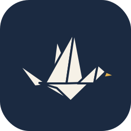

# Zajel app icon

Zajel (زاجل) is named after *Hamam al-Zajel*, the carrier pigeon. The icon is a pigeon folded from a sheet of paper: the letter becomes the messenger.

Design source: [Figma — Zajel App Icon Exploration](https://www.figma.com/design/pNsEtqPon0qJi3nf1AXVOK)

## Default: A · Day

Sky-blue origami pigeon on pale paper-blue. This is the icon shipped in `static/` (favicon, PWA, Apple touch icon).

| Role | Hex |
| --- | --- |
| Background | `#EAF2F6` |
| Front wing (lit) | `#6CB2D8` |
| Front wing (shade), neck | `#3F86B3` |
| Tail | `#3A7FA8` |
| Body, head | `#24597A` |
| Back wing | `#1F4E6B` |
| Belly shadow | `#183F57` |
| Beak | `#E3B04B` |

Light comes from the top-left: wing faces are lightest, the belly is darkest.

## Alternates

Kept as options (for example a theme-matched or user-selectable app icon). Same geometry, different palette.

| | Variant | Use |
| --- | --- | --- |
|  | **B · Night** — `icons/zajel-b-night.svg` | Dark docks / dark-mode builds |
|  | **C · Paper** — `icons/zajel-c-paper.svg` | White paper bird on a teal gradient; strongest contrast on busy wallpapers |
|  | **D · Mono glyph** — `icons/zajel-d-mono.svg` | Single-colour mark (tray, notifications). Needs simplifying before use below 32 px |

## Shipped files (`static/`)

| File | Size | Notes |
| --- | --- | --- |
| `icon.svg` | vector | Master, rounded tile; also served as the SVG favicon |
| `icon-512.png`, `icon-192.png` | 512, 192 | Manifest `purpose: any` |
| `icon-maskable-512.png` | 512 | Full-bleed background, bird scaled to 82% to sit inside the maskable safe zone |
| `apple-touch-icon.png` | 180 | Square, no rounding (iOS applies its own mask) |
| `favicon-48.png`, `favicon-32.png` | 48, 32 | Browser tab |

## Geometry

All variants are drawn on a 512 × 512 grid with a 114 px corner radius. The bird is 10 polygons, offset by `translate(-14 26)` so it sits optically centred. Coordinates are in the SVG masters in `icons/`; change those to regenerate every size.
